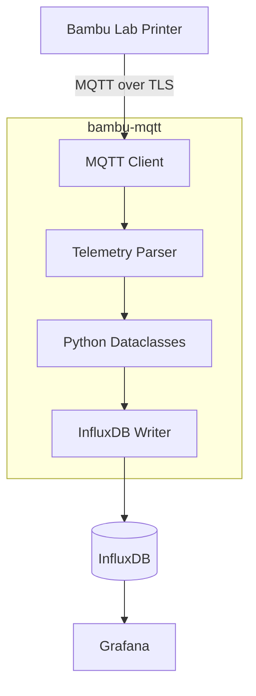

# bambu-mqtt

**A Python-based MQTT telemetry collector for Bambu Lab 3D printers.**

`bambu-mqtt` connects to a Bambu Lab printer over its local MQTT interface using TLS, parses printer and AMS telemetry into structured Python dataclasses, and exports the collected data to InfluxDB for monitoring and visualization.

Designed for self-hosted monitoring setups using InfluxDB and Grafana.

## Features

- Connects to Bambu Lab printers through local MQTT.
- Uses TLS certificate authentication.
- Parses MQTT status messages into structured telemetry objects.
- Tracks printer status, print progress and layer information.
- Collects nozzle, bed and chamber temperature readings.
- Monitors Wi-Fi signal strength.
- Supports multiple AMS units and their individual filament trays.
- Exports telemetry to InfluxDB.
- Uses Python logging for configurable runtime diagnostics.

## Architecture



## Requirements

- A compatible Bambu Lab printer with local MQTT access.
- Developer mode enabled on the printer, where required.
- Python.
- An MQTT TLS certificate.
- An InfluxDB 2.x instance.
- An InfluxDB API token with write permissions.

## Installation

Clone the repository:

```bash
git clone https://github.com/NullVanta/bambu-mqtt.git
cd bambu-mqtt
```

Install the project dependencies using Pipenv:

```bash
pipenv install
```

For development dependencies:

```bash
pipenv install --dev
```

## Configuration

Before starting the collector, obtain the required printer connection information:

| Parameter | Description |
|---|---|
| Host | Printer's local IP address |
| Access code | Printer's LAN access code |
| Certificate | TLS certificate used for authentication |
| InfluxDB URL | InfluxDB server address |
| InfluxDB token | API token with bucket write access |
| InfluxDB organization | Target InfluxDB organization |
| InfluxDB bucket | Target bucket for telemetry |

The printer device ID is derived from the certificate's Common Name (CN).

Set your InfluxDB token as an environment variable:

```bash
export INFLUXDB_TOKEN="your-influxdb-token"
```

## Usage

Start the collector:

```bash
pipenv run python -m bambu_mqtt \
    --host 192.168.0.240 \
    --cert ./blcert.pem \
    --access-code YOUR_ACCESS_CODE \
    --influx-url http://localhost:8086 \
    --influx-org YOUR_ORG \
    --influx-bucket bambulab
```

### Command-line arguments

| Argument | Description |
|---|---|
| `-H`, `--host` | Printer IP address |
| `--access-code` | Printer LAN access code |
| `-c`, `--cert` | Path to the TLS certificate |
| `-l`, `--log-level` | Logging verbosity |
| `-v`, `--version` | Display application version |
| `--influx-url` | InfluxDB server URL |
| `--influx-token` | InfluxDB API token |
| `--influx-org` | InfluxDB organization |
| `--influx-bucket` | InfluxDB destination bucket |

Supported log levels:

`DEBUG`, `INFO`, `WARNING`, `ERROR`, `CRITICAL`

The default logging level is `INFO`.

## Telemetry

Telemetry is normalized into structured Python dataclasses before being passed to the configured writer.

### Printer

- Printer state
- Print progress
- Current layer
- Total layers
- Remaining print time
- Job name

### Temperatures

- Nozzle temperature
- Nozzle target temperature
- Bed temperature
- Bed target temperature
- Chamber temperature
- Chamber target temperature, when available

### Connectivity

- Wi-Fi signal strength

### AMS

- AMS identifier
- AMS temperature
- Humidity
- Raw humidity
- Individual filament tray information

### Filament trays

- Tray identifier
- Filament type
- Filament colour
- Remaining filament percentage
- Minimum and maximum nozzle temperatures
- Filament diameter
- Filament spool weight

Unavailable telemetry fields are represented as `None`.

## InfluxDB measurements

The InfluxDB writer currently exports three measurements:

| Measurement | Contents |
|---|---|
| `printer` | Printer status, temperatures and connectivity |
| `ams` | AMS temperature and humidity |
| `ams_tray` | Individual filament tray information |

These measurements can be queried in Grafana using Flux.

## Logging

The application uses Python's standard logging framework.

Example output:

```text
INFO | Connected to printer
DEBUG | Subscribed to MQTT topic
INFO | Received MQTT message, parsing now
INFO | Connecting to InfluxDB
INFO | Successfully connected to InfluxDB
DEBUG | Successfully wrote 6 telemetry points
INFO | Telemetry written to InfluxDB successfully
```

Logging verbosity can be adjusted using `--log-level`.

## Development

The project uses Pipenv for dependency management.

Install development dependencies:

```bash
pipenv install --dev
```

Run the application:

```bash
pipenv run python -m bambu_mqtt
```

### Code quality

The project uses:

- Black for code formatting.
- Pylint for static code analysis.

Run the checks:

```bash
pipenv run black --check bambu_mqtt
pipenv run pylint bambu_mqtt
```

## Project status

`bambu-mqtt` is under active development.

The initial release focuses on local MQTT connectivity, telemetry parsing and InfluxDB integration.

## License

See [LICENSE](LICENSE) for licensing information.
